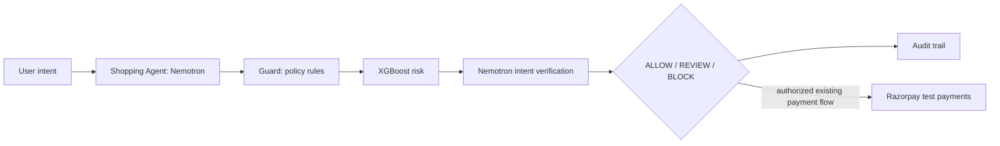
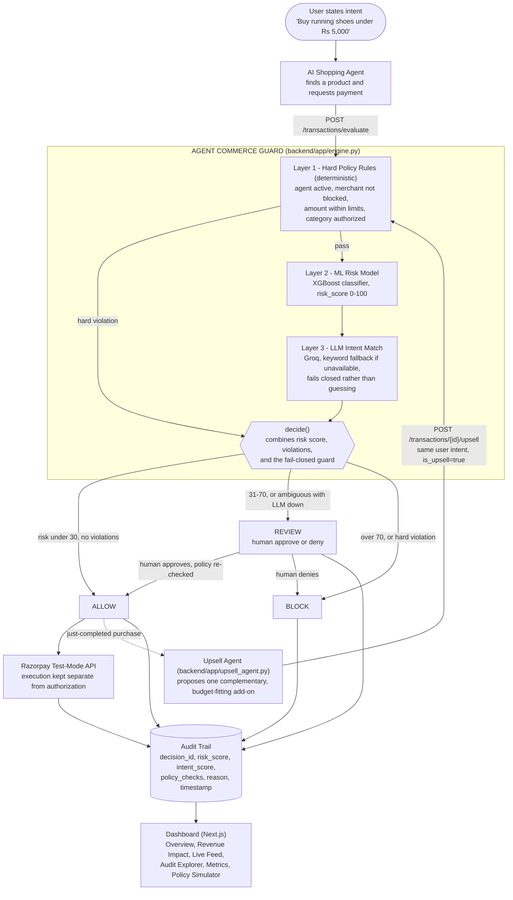

# Open Agent Hackathon 2026 — Track: Reasoning Architecture

**An AI shopping agent that can't be tricked into spending your money: data, rules, memory and Nemotron reasoning combine into one reliable ALLOW/REVIEW/BLOCK decision before any payment.**

PayWall.ai's shopping agent reads the merchant catalog from **Zetaris**, recalls similar past decisions from the **Meterless H-MEM** engine, asks **NVIDIA Nemotron through Meterless Nightshift** to pick one product, and hands it to the Guard, which independently authorizes it (its own intent check also runs on Nemotron). If the Guard blocks the pick, the shopper retries once with that product excluded. Prices and merchant IDs always come from server data, never from the model. The catalog is a 15-row development dataset linked to the seeded merchants, not live inventory.

| Track component | Implementation |
| --- | --- |
| Data | XGBoost risk model on 7,000 synthetic transactions, split 80/20 for training/holdout |
| Knowledge | Deterministic agent, merchant, category, transaction-limit and daily-budget policies |
| Memory | Meterless H-MEM: recalls similar past purchase decisions before each pick and saves every outcome; plus daily spend, history and audit trail in the database |
| Reasoning | Nemotron catalog selection, independent intent check, complementary upsell selection |
| Reliable decisions | Existing fail-closed Guard: uncertain autonomous approvals become REVIEW; violations BLOCK |
| Actions | Existing Razorpay test payment flow after Guard authorization |

| Sponsor technology | Where and what |
| --- | --- |
| Zetaris (data layer) | `backend/app/zetaris.py`, `backend/scripts/zetaris_setup.py`: the catalog export (`backend/data/zetaris/catalog.csv`) is registered as the file-store table `paywall.catalog`; every live shopping request reads it with SQL. If Zetaris is down, the labelled sample copy is used and the trace says so |
| Meterless Nightshift (primary AI provider) | `backend/app/ml/intent_matcher.py`: all model calls go to the Nightshift runtime (`METERLESS_BASE_URL`, OpenAI-compatible), model `nvidia/nemotron-3.5-lightning-30b-a3b`; NVIDIA direct, Groq and OpenAI remain fallbacks |
| Meterless Engine: H-MEM | `backend/engines/hmem/` (unmodified Apache-2.0 reference, run by Node 22 via `cli.ts`), called from `backend/app/hmem_bridge.py`: recall before each pick, save after each Guard decision |
| NVIDIA Nemotron | Served through Nightshift: picks the product (ShopperAgent) and verifies intent inside the Guard; the served model is logged on every request |
| Cursor | Original development editor; this extension was implemented with Claude Code and Codex |



The diagram shows the conceptual layers. In code, intent is computed before XGBoost because intent similarity is one of the model's inputs. The Guard, rather than the shopping or upsell model, makes the authorization decision.

**Added during this hackathon:** Zetaris catalog data layer, Meterless Nightshift provider, H-MEM memory, the five-agent trace with a Guard-driven retry, NVIDIA-first provider selection, `/agent/shop`, the local catalog, model provenance in API decision responses and audit payloads, Nemotron upsell selection with reasons, and the dashboard Shopping Agent box. Reused: the three-layer engine, trained risk model, policies, database memory, dashboards, review workflow and Razorpay integration. The original application (Guard, risk model, policies, dashboards, Razorpay flow) was built before the build window and is declared as pre-existing.

### Agents and trace

Each `/agent/shop` call writes JSON lines to stdout and `backend/logs/<run_id>.jsonl`:
`PlannerAgent` (parses the budget in code) → `CatalogAgent` (Zetaris SQL) → `MemoryAgent` (H-MEM recall) → `ShopperAgent` (Nemotron via Nightshift) → `GuardAgent` (policy, risk model, Nemotron intent check; on BLOCK it sends the shopper back once with that product excluded) → `MemoryAgent` (H-MEM save). Live examples with their traces: `input_examples/`, `output_examples/`.

### Run with live sponsors

```sh
cd backend
python scripts/zetaris_setup.py        # registers paywall.catalog in Zetaris and reads it back
python -m uvicorn app.main:app --port 8000
curl -X POST localhost:8000/agents -H "Content-Type: application/json" -d '{"name":"Shopper","max_transaction":5000,"daily_limit":10000,"allowed_categories":["sports","electronics","food","groceries"],"blocked_categories":[],"requires_approval_above":4900}'
curl -X POST localhost:8000/agent/shop -H "Content-Type: application/json" -d '{"agent_id":"<id>","user_intent":"Buy running shoes for my first marathon under 5000"}'
```

H-MEM engine test: `python -m pytest tests/test_hmem_engine.py` (saves two decisions through the real engine and recalls the relevant one).

`SAMPLE_MODE=true` runs the same flow with no Nightshift or Zetaris (labelled sample catalog and rules-based choice; H-MEM still runs locally on Node 22).

### Hackathon setup

1. Install backend dependencies with `cd backend`, `python -m pip install -r requirements.txt -r requirements-dev.txt`.
2. Copy `backend/.env.example` to `backend/.env`. For local SQLite use `DATABASE_URL=sqlite:///./agent_guard.db`. Leave unused provider/payment keys empty instead of the example placeholders.
3. Set `NVIDIA_API_KEY` and `NVIDIA_MODEL` in **backend/.env only**. Choose a current Nemotron model ID from [NVIDIA's catalog](https://build.nvidia.com). The API uses the [documented hosted endpoint](https://docs.api.nvidia.com/nim/reference/llm-apis), `https://integrate.api.nvidia.com/v1`, through the existing OpenAI Python client. No fixed model ID is assumed.
4. Seed data with `python scripts/seed_db.py`, then start the backend with `python -m uvicorn app.main:app --port 8000` from `backend`.
5. In another terminal, `cd frontend`, `npm ci`, then `npm run dev`. Open `http://localhost:3000/dashboard`. The frontend defaults to `http://localhost:8000`; use `NEXT_PUBLIC_API_URL` to change it, never for server API keys.
6. Run `cd backend && python -m pytest -q`, and `cd frontend && npm run build`. With both servers running, run `npm run e2e` from `frontend`.

**Provider behavior:** NVIDIA (when key and model are set) → Groq → OpenAI → keyword fallback labeled `rules_only`. Calls have a 10-second timeout and no SDK retries. Invalid catalog IDs, malformed responses and nonfinite/out-of-range intent scores are rejected. Model selection cannot override policy failures. The existing engine retains its tested small, unequivocal low-risk fallback exception; ambiguous purchases become REVIEW or BLOCK according to risk, never an invented LLM approval.

**API:** `POST /agent/shop` with `{"agent_id":"AGT-001","user_intent":"Buy running shoes under 5000"}` returns `intent`, verified `agent_proposal`, `agent_reasoning`, proposal `model`, `guard_model`, `decision`, `risk_score`, `intent_score`, `reasons`, and `transaction_id`. The new shopping endpoint records authorization and reserves daily spend through the existing engine, but **does not execute payment**. Existing payment/review routes remain separate. This is an authorization demo, not a new checkout UI.

### Three-minute recording

- **0:00–0:30:** Explain the problem and the Data / Knowledge / Memory / Reasoning architecture. Show the Shopping Agent box.
- **0:30–1:20:** Enter “Buy running shoes under 5000.” Show the catalog-backed proposal, model names, Guard decision, scores and audit transaction ID. A configured, responding LLM should produce ALLOW for a matching low-risk purchase on a fresh agent.
- **1:20–2:10:** Propose an upsell through `POST /transactions/{transaction_id}/upsell`. Nemotron can select ₹149 running socks. Then evaluate a ₹14,999 insurance “Premium Protection Plan” against the same shoes intent; policy rejects it even if a model claims a match.
- **2:10–2:50:** Call `POST /dashboard/llm-toggle?disabled=true`, then shop for “Buy shoes or running shoes under 5000.” Show `rules_only` and REVIEW. Restore with `?disabled=false`.
- **2:50–3:00:** Show the audit trail and explain the deployment/credential limitations honestly.

Run `python scripts/demo_shopping.py` from `backend` for the live HTTP cases (seed merchants first). For a reproducible **mocked-inference** demonstration without credentials, run `python scripts/demo_shopping.py --mock-llm`; this uses the real Guard and an isolated in-memory database. Mocked inference is not evidence of live NVIDIA connectivity. Live results, including model outages and BLOCK/REVIEW outcomes, are printed unchanged. Use a fresh demo agent to avoid accumulated daily spend and velocity changing subsequent decisions.

Slide outline: **1)** the payment manipulation problem; **2)** five track components and architecture; **3)** legitimate purchase vs. malicious upsell; **4)** outage behavior, audit evidence, sponsor integration and known limits.

Current scope: local catalog, simple numeric budget phrases, and existing model-based semantic verification. Full structured intent parsing, live inventory, external memory/data integrations and a new user-confirmed checkout are outside this small extension. Live Nemotron and Razorpay verification require valid credentials; see the [verification report](docs/hackathon-verification.md) for results of this run.

---

# Agent Commerce Guard

> Razorpay AI Buildathon 2026 — Track 01: AI Growth & Agentic Commerce
> The trust layer that lets AI agents spend money safely.

**Live demo:** [paywall-ai-orcin.vercel.app](https://paywall-ai-orcin.vercel.app)
**API:** [paywall-ai-backend.onrender.com/docs](https://paywall-ai-backend.onrender.com/docs)
**Repository:** [github.com/Lakshmikanth-3/PayWall.ai](https://github.com/Lakshmikanth-3/PayWall.ai)

---

## Table of Contents

- [Problem](#problem)
- [Architecture](#architecture)
- [Revenue growth vs. safety — one pipeline](#revenue-growth-vs-safety--one-pipeline)
- [Three-layer decision engine](#three-layer-decision-engine)
- [Quick start](#quick-start)
- [Environment variables](#environment-variables)
- [API reference](#api-reference)
- [Demo scenarios](#demo-scenarios)
- [Pre-seeded data](#pre-seeded-data)
- [Testing](#testing)
- [Dataset and evaluation](#dataset-and-evaluation)
- [Deployment](#deployment)
- [Tech stack](#tech-stack)
- [Known limitations](#known-limitations)

---

## Problem

AI agents are moving from recommending products to actually purchasing them for users. An agent that can complete a purchase can also be manipulated mid-checkout into paying for something the user never asked for, at a price they never approved.

Traditional fraud detection asks: *"Is this transaction fraudulent?"*

Agent Commerce Guard asks: *"Is this transaction authorized, consistent with the user's intent, within policy, and safe to execute?"*

The agent proposes a payment. The Guard authorizes it. Only an `ALLOW` (or a human-approved `REVIEW`) ever reaches Razorpay.

---

## Architecture



**Core principle:** the AI proposes, the Guard authorizes. The agent never receives unrestricted authority to move money.

---

## Revenue growth vs. safety — one pipeline

Section 2a of the product spec: the Guard alone only ever prevents loss. The **Upsell Agent** is what makes it a growth product too.

After an `ALLOW`ed purchase, it proposes one budget-fitting complementary item (running socks after running shoes, a charging cable after a phone). That proposal is evaluated by the **exact same Guard pipeline** as any other payment — same identity check, same intent match against the original user intent, same policy and risk layers. It has no special authority.

| Scenario | Example | Result |
|---|---|---|
| Legitimate upsell | Running socks, Rs 149, offered after a shoe purchase | `ALLOW` — counts as incremental GMV |
| Manipulated "upsell" | Protection plan, Rs 14,999, disguised as a checkout add-on | `BLOCK` — same code path, same reasons as any other unauthorized payment |

Both outcomes are tracked on the dashboard's **Merchant Revenue Impact** panel (`GET /dashboard/revenue-impact`): upsells proposed/allowed/blocked/reviewed, incremental GMV from allowed upsells, and exposure prevented from blocked ones.

---

## Three-layer decision engine

| Layer | Technology | Purpose |
|---|---|---|
| 1 — Hard Policy | Deterministic rules | Agent status, merchant blocklist, transaction/daily limits, category authorization |
| 2 — ML Risk Model | XGBoost, heuristic fallback | Risk score 0–100 from amount deviation, merchant risk, velocity, budget headroom |
| 3 — LLM Intent Match | Groq (OpenAI-compatible), keyword fallback | Does the payment match what the user actually asked for |

Layer 1 can short-circuit straight to `BLOCK`. Layers 2 and 3 always run and are combined by `app/engine.py::decide()`. If the LLM is unavailable, the fallback keyword scorer is treated as a degraded signal: the engine only auto-`ALLOW`s when the hard policy alone makes the transaction unambiguously safe (small amount, low-risk merchant, high keyword match); otherwise it downgrades to `REVIEW` rather than guessing. This fail-closed rule is exercised directly in the test suite and can be triggered live from the dashboard's "AI Reasoning" toggle.

| Risk score | Decision |
|---:|---|
| 0–30 | ALLOW |
| 31–70 | REVIEW |
| 71–100 | BLOCK |

Configurable via `ALLOW_THRESHOLD` / `REVIEW_THRESHOLD` env vars.

---

## Quick start

### Backend (FastAPI)

```powershell
cd backend
python -m venv venv
.\venv\Scripts\pip install -r requirements.txt

# Generate the synthetic dataset and train the risk model (first run only)
.\venv\Scripts\python scripts/generate_dataset.py
.\venv\Scripts\python scripts/train_model.py
.\venv\Scripts\python scripts/evaluate_dataset.py

# Seed demo agents, merchants, and transaction history
.\venv\Scripts\python scripts/seed_db.py

# Validate the PRD demo fixtures before presenting
.\venv\Scripts\python scripts/validate_fixtures.py

# Start the API (http://localhost:8000)
.\venv\Scripts\uvicorn app.main:app --reload
```

### Frontend (Next.js)

```powershell
cd frontend
npm install
npm run dev   # http://localhost:3000
```

The landing page is served at `/`; the working dashboard is at `/dashboard`.

---

## Environment variables

Create `backend/.env`:

```env
DATABASE_URL=sqlite:///./agent_guard.db   # default for local dev; Postgres in production
SECRET_KEY=change-me                      # also gates POST /admin/seed
GROQ_API_KEY=gsk_...                      # optional — enables live LLM intent matching
OPENAI_API_KEY=sk-...                     # optional fallback if GROQ_API_KEY is unset
RAZORPAY_KEY_ID=rzp_test_...              # optional — for real test-mode payment execution
RAZORPAY_KEY_SECRET=...
ALLOW_ORIGINS=http://localhost:3000
```

The system works without any LLM key configured — it falls back to deterministic keyword-based intent matching and fails closed to `REVIEW` for anything ambiguous. It also works without Razorpay credentials — payments are recorded as `SKIPPED` rather than blocking the decision.

For the frontend, set `NEXT_PUBLIC_API_URL` to the backend's URL (defaults to `http://localhost:8000`).

---

## API reference

| Method | Endpoint | Description |
|---|---|---|
| `POST` | `/agents` | Register an AI agent with a spending policy |
| `GET` | `/agents` | List all agents |
| `PATCH` | `/agents/{id}/suspend` \| `/activate` | Revoke or restore payment authority |
| `DELETE` | `/agents/{id}` | Permanently remove an agent and its transaction/audit history (test data cleanup — real agents should be suspended, not deleted) |
| `POST` | `/agents/{id}/simulate-policy` | Replay history against a proposed policy change |
| `POST` | `/merchants` | Register a merchant |
| `PATCH` | `/merchants/{id}/block` | Block a merchant |
| `DELETE` | `/merchants/{id}` | Permanently remove a merchant (test data cleanup — real merchants should be blocked, not deleted) |
| `POST` | `/transactions/evaluate` | Evaluate a payment request through the Guard |
| `GET` | `/transactions/{id}` | Fetch a transaction's full decision record |
| `POST` | `/transactions/{id}/review` | Human approve/deny a `REVIEW` transaction (re-checks policy) |
| `POST` | `/transactions/{id}/upsell` | Propose and evaluate an upsell for an `ALLOW`ed purchase |
| `POST` | `/transactions/{id}/retry-payment` | Retry a failed Razorpay call without re-authorizing |
| `GET` | `/dashboard/stats` | Aggregate statistics |
| `GET` | `/dashboard/metrics` | Precision/recall/F1/ROC-AUC and latency |
| `GET` | `/dashboard/revenue-impact` | Upsell Agent performance (Section 2a) |
| `GET` | `/dashboard/live` | Latest transactions |
| `GET` | `/dashboard/audit` | Searchable audit trail |
| `POST` | `/dashboard/llm-toggle` | Force the LLM offline to demo fail-closed behavior |
| `POST` | `/admin/seed` | Seed a deployed instance's own database (`X-Admin-Key: <SECRET_KEY>`; add `?force=true` to wipe and fully re-seed if a prior run was interrupted) |

Full interactive docs: `/docs` on whichever host you're running (local or the live API above).

---

## Demo scenarios

### Normal purchase — ALLOW

```json
{
  "agent_id": "AGT-001",
  "merchant_id": "MER-001",
  "amount": 4799,
  "category": "sports",
  "product": "Nike Running Shoes",
  "user_intent": "Buy running shoes under 5000"
}
```

Result: `ALLOW`. Risk score under 20, intent match at or above 0.90 (live LLM).

### Legitimate upsell — ALLOW

Proposed automatically via `POST /transactions/{shoes_txn_id}/upsell` after the purchase above:

```
Moisture-wicking Running Socks, Rs 149 — within the remaining daily budget
```

Result: `ALLOW`. Counts as incremental GMV on the Revenue Impact panel.

### Manipulated upsell (the killer scenario) — BLOCK

```json
{
  "agent_id": "AGT-001",
  "merchant_id": "MER-001",
  "amount": 14999,
  "category": "insurance",
  "product": "Premium Protection Plan",
  "user_intent": "Buy running shoes under 5000",
  "is_upsell": true
}
```

Result: `BLOCK`. Risk score above 70, intent match under 0.20, category not authorized for the agent. Reasons: amount exceeds the user's limit, product does not match user intent, category not authorized.

### Budget violation — BLOCK

Requesting more than an agent's remaining daily budget always blocks, regardless of merchant risk or intent match.

### Human review — REVIEW then approve

A medium-risk-merchant purchase lands in `REVIEW`. `POST /transactions/{id}/review` with `{"approved": true}` re-runs Layer 1 against current state (budget may have changed since the original decision) before calling Razorpay.

---

## Pre-seeded data

Created by `scripts/seed_db.py` (or `POST /admin/seed` on a deployed instance with no shell access).

### Agents

| ID | Name | Max transaction | Daily limit | Approval required above |
|---|---|---:|---:|---:|
| AGT-001 | Shopping Assistant | Rs 5,000 | Rs 10,000 | Rs 4,900 |
| AGT-002 | Travel Booker | Rs 20,000 | Rs 50,000 | Rs 10,000 |
| AGT-003 | Office Supply Agent | Rs 2,000 | Rs 5,000 | Rs 1,500 |

### Merchants

| ID | Name | Risk |
|---|---|---|
| MER-001 | Nike Official Store | LOW (8) |
| MER-002 | Amazon India | LOW (5) |
| MER-006 | QuickShop24 | MEDIUM (65) |
| MER-007 | ShadyDeals.in | HIGH (88) |
| MER-010 | SwiftGrocers | MEDIUM (35) |

---

## Testing

### Backend — pytest

100 tests, 89%+ overall coverage, 100% on the decision engine (`app/engine.py`). Runs fully offline against an in-memory database with the LLM and Razorpay calls disabled, so it never depends on external quota or network access.

```powershell
cd backend
.\venv\Scripts\pip install -r requirements-dev.txt
.\venv\Scripts\pytest tests/ -v --cov=app --cov-report=term-missing
```

Covers: Layer 1 policy checks, the `decide()` combiner (including the fail-closed path), the ML risk model, the keyword intent fallback, the Upsell Agent's budget-fitting logic, full `evaluate()` orchestration and persistence, and every API endpoint.

### Frontend — Playwright end-to-end

16 tests driven against the real running app (landing page, all eight dashboard routes, the killer-scenario `BLOCK`, a clean `ALLOW`, the upsell propose flow, and the LLM fail-closed toggle).

```powershell
cd frontend
npx playwright install chromium
npm run e2e
```

Requires the backend and frontend dev servers running locally (or set `E2E_BASE_URL` / `E2E_API_URL` to point elsewhere — the full suite also passes against the live Vercel + Render deployment linked above).

---

## Dataset and evaluation

`scripts/generate_dataset.py` produces a 7,000-row synthetic dataset at the hackathon-MVP scale, with an 80/20 train/holdout split:

| Scenario type | Rows |
|---|---:|
| Normal | 4,900 |
| Budget violation | 700 |
| Category violation | 350 |
| Intent mismatch | 350 |
| Suspicious merchant | 280 |
| Anomalous behavior | 210 |
| Velocity/duplicate | 140 |
| Mixed attack (includes manipulated-upsell rows) | 70 |

`scripts/evaluate_dataset.py` reports held-out metrics using the *same* `decide()` function the live engine uses — never a re-implementation that can drift. Because it never calls a live LLM, it doubles as a large-scale exercise of the fail-closed path: every holdout row is scored as if the LLM were permanently down. The current report (`backend/data/eval_report.json`) reflects that worst case — a real, honestly-reported number, not tuned toward a target. In normal operation with the LLM online (the default, and what `scripts/seed_db.py` and the live demo use), a much larger share of clean transactions resolve to `ALLOW` instead of the conservative `REVIEW` this holdout run shows.

The held-out set is never used to tune thresholds — only to report final numbers.

---

## Deployment

- **Frontend:** Vercel, deployed from `frontend/`. Set `NEXT_PUBLIC_API_URL` to the backend's public URL.
- **Backend:** Render, deployed via `render.yaml` (Blueprint) from the repo root, `rootDir: backend`. Uses a Render-managed Postgres instance rather than local SQLite, since Render's free-tier web services have an ephemeral filesystem that would otherwise wipe the database on every restart.
- **Seeding a deployed instance:** `POST /admin/seed` with header `X-Admin-Key: <SECRET_KEY>` runs the same seeding logic as the local `scripts/seed_db.py`, without needing shell or filesystem access.

---

## Tech stack

- **Frontend:** Next.js 16, TypeScript, Tailwind CSS, Framer Motion, Recharts
- **Backend:** Python, FastAPI, SQLAlchemy (SQLite for dev, PostgreSQL in production)
- **ML:** XGBoost with a deterministic heuristic fallback
- **AI:** Groq (OpenAI-compatible), with a keyword-based fallback that fails closed
- **Payments:** Razorpay Test Mode
- **Testing:** pytest, Playwright

---

## Known limitations

- Merchant risk signals are synthetic, as scoped for the buildathon.
- The held-out evaluation report reflects the LLM-unavailable worst case (see [Dataset and evaluation](#dataset-and-evaluation)) — live, LLM-enabled behavior differs and is what the actual demo and dashboard show.
- The Policy Simulator reuses each historical transaction's already-stored risk score rather than re-running the ML model against a proposed policy, since recomputing the original feature snapshot (e.g. merchant risk at that point in time) isn't preserved. Only the policy-dependent inputs (limits, categories, budget replay) are re-evaluated.
